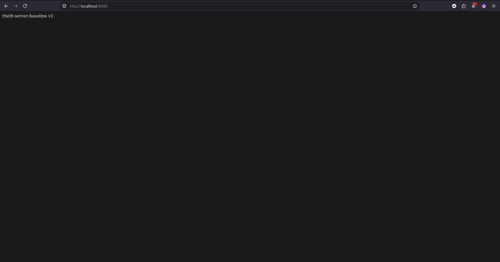

# 06 — Rootless Web Container

## Goal

- `/srv/web/html` is owned by `webapp` and contains `index.html` with `rhel9-server-baseline v2`
- A rootless container `webserver` runs as `webapp`, from `registry.access.redhat.com/ubi9/httpd-24`
- Host port 8080 maps to container port 8080
- `/srv/web/html` is mounted into the container at `/var/www/html`, read-only
- The container starts at boot without anyone logging in

## Commands

### Prepare the service account (as an admin)

```bash
cat /etc/subuid
sudo usermod --add-subuids 231072-296607 --add-subgids 231072-296607 webapp
sudo loginctl enable-linger webapp
```

`webapp` is a system account (Stage 1), and system accounts don't get sub-UID ranges automatically. The range starts right after the last one in `/etc/subuid`, so nothing overlaps.

### Content

```bash
sudo mkdir -p /srv/web/html
echo 'rhel9-server-baseline v2' | sudo tee /srv/web/html/index.html
sudo chown -R webapp:webapp /srv/web/html
ls -lZ /srv/web/html
```

The `container_file_t` label comes from the Stage 4 rule.

### Open a real session as webapp

```bash
sudo dnf install -y systemd-container
sudo machinectl shell webapp@ /bin/bash
```

`webapp` has no login shell, so `su - webapp` doesn't work. `machinectl shell` starts a full systemd session, which sets `XDG_RUNTIME_DIR` and the user's systemd instance that rootless podman needs.

### Test run (as webapp)

```bash
podman run -d --name webserver -p 8080:8080 \
  -v /srv/web/html:/var/www/html:ro \
  registry.access.redhat.com/ubi9/httpd-24
curl -s http://localhost:8080
podman rm -f webserver
```

### Run as a service with Quadlet (as webapp)

`~/.config/containers/systemd/webserver.container`:

```ini
[Unit]
Description=Rootless web server for rhel9-server-baseline

[Container]
ContainerName=webserver
Image=registry.access.redhat.com/ubi9/httpd-24
PublishPort=8080:8080
Volume=/srv/web/html:/var/www/html:ro

[Install]
WantedBy=default.target
```

```bash
systemctl --user daemon-reload
systemctl --user start webserver.service
systemctl --user status webserver.service
```

## Why these choices

- **Rootless:** inside the container, root maps to `webapp` (UID 985) on the host, and other container UIDs map into webapp's sub-UID range. A container breakout lands in an unprivileged account.
- **Port 8080:** unprivileged users can't bind ports below 1024.
- **Read-only volume:** the web server only needs to read the content, so it can't modify it.
- **Lingering:** lets webapp's user services start at boot without a login session.
- **Quadlet instead of `podman generate systemd`:** `generate systemd` is deprecated. A Quadlet file is short, describes the container directly, and is turned into a systemd service on `daemon-reload`. No `enable` is needed; the `[Install]` section handles boot.

## Verification

```
$ podman info --format '{{.Host.IDMappings.UIDMap}}'     # as webapp
[{0 985 1} {1 231072 65536}]
```

After a reboot, without logging in as webapp:

```
$ curl -s http://localhost:8080
rhel9-server-baseline v2


$ sudo ./scripts/verify.sh
...
PASS: webapp lingering is enabled
PASS: port 8080 serves the v2 page
Result: 19/19 checks passed
```

## Changes from v1

- Service account renamed from `websvc` to `webapp`
- v1 hit three problems: missing sub-UID/GID ranges, a broken login session, and an HTTP 403 caused by SELinux labels and permissions together. In v2 each was prevented up front: ranges added before running podman, `machinectl shell` for a real session, and `container_file_t` set in Stage 4.
- Switched from `podman generate systemd` to Quadlet
- Content mounted read-only
